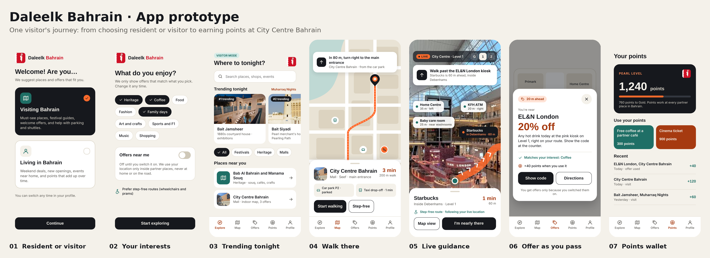

# Daleelk Bahrain

**Your guide to every place you visit in Bahrain.** A clickable app prototype built for the Mutamahin 11th Cohort Startup Pitch Challenge (CFA Society Bahrain).

**Live prototype:** https://mohammedbaqerdata.github.io/daleelk-bahrain/

## The problem
Bahrain had more than 15 million visitors in 2025, but getting around festivals, heritage sites and malls is hard. Every place has its own app or web page, and businesses can only reach visitors with ads they see at home.

## The solution
One app for every place a visitor goes in Bahrain:

| Screen | What it does |
| --- | --- |
| Resident or visitor | Tailors suggestions and offers to each type of user |
| Your interests | Offers stay off until the user switches them on |
| Explore | "Trending tonight" at Muharraq Nights: Bait Jamsheer and Bait Siyadi |
| Walk there | Route from the car park to City Centre Bahrain |
| Live guidance | Arrows on the camera view lead through Level 1 to the destination |
| Offer | An offer from a business the user walks past, matched to their interests |
| Points | One loyalty balance across every partner place |

## How to view it
Open `index.html`, or the live link above, and click **Open the clickable prototype**. Use the buttons and bottom menu to move between screens.

## Built with
HTML and CSS (static prototype).

## Team
- **Mohammed Baqer** – Lead · Product and business development
- **Zainab Taher** – Tech
- **Hala Benlaba** – Marketing and research

## Notes
Store names, offers, distances and point totals are examples for the demo and do not imply any partnership. Photos are used for demonstration only and belong to their owners.
